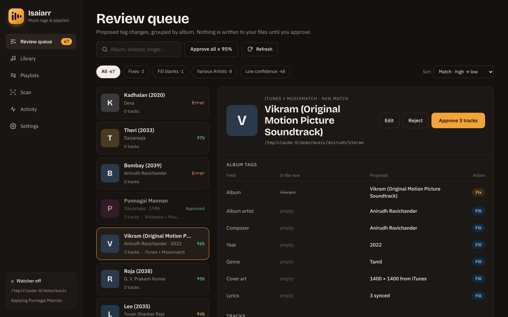

# Isaiarr

[](https://github.com/gera-devp/isaiarr/actions/workflows/docker.yml)
[](https://github.com/gera-devp/isaiarr/pkgs/container/isaiarr)
[](LICENSE)


**Music tags & playlists for Plex.** A self-hosted Docker app that fixes the tags on your music
library, in any language, and builds playlists from the songs you own. It was built for Indian film
music, where the music director and the singers need to be kept apart (*isai* means music in Tamil). It uses **iTunes** for album metadata and artwork, falls back to **JioSaavn**, **Wikipedia**, **Discogs** and then **Deezer** when iTunes is missing the album or only has part of it, and gets lyrics from **Musixmatch** (with JioSaavn as a backup). Songs no source finds by title are identified by their sound with **Shazam**, and the music director of a film album can be checked against **TMDB**.

- **Album Artist = music director** (from the iTunes album artist). Albums with several composers become `Various Artists`.
- **Artist = singers** (from the iTunes track artist), so you can still browse by singer.
- **Composer = music director** (optional).
- Album, track/disc numbers, year, genre and 1400px artwork come from iTunes (India storefront) exactly as iTunes returns them.
- **Release date and record label**: the full date (Plex's *Originally Available*) and the label (*Record Label*), when a source has them.
- Lyrics come from Musixmatch: plain lyrics are embedded, and synced lyrics are written as a `.lrc` sidecar (Plex shows synced lyrics from it).
- Tracks are renamed to `01 - Title.flac` (or `1-01 - Title.flac` for multi-disc albums).
- Supports FLAC, MP3 (ID3v2.3/2.4) and M4A.

## How it works

```
new folder copied ─► watcher (waits until copy finishes) ─┐
manual "Scan folder" ─────────────────────────────────────┼─► analyze ─► review queue ─► you approve ─► write tags + rename ─► Plex partial scan
                                                          │      │                         │
                                                          │      └─ Discord summary        └─ backup of original tags (one-click undo)
```

1. **Detect.** The watcher polls the library every 60 s by default. A folder counts as new when it contains audio file names that weren't there before. It is queued only after `SETTLE_SECONDS` with no further changes and stable file sizes, so half-copied albums are never touched. Files added while the container was down are picked up on restart.
2. **Analyze.** Each folder is one album. Isaiarr searches iTunes using the album tag (or folder name) plus the album artist (or parent folder name). It scores candidates on name, artist, track count and Tamil genre, then checks the top three against your actual files by title, duration and track number.
   - If the best iTunes match is below `FALLBACK_BELOW` confidence or covers less than `FALLBACK_COVERAGE` of the files, JioSaavn is searched as well, then Wikipedia, then Discogs, then Deezer, and the more complete match wins. An album that holds fewer than a third of the folder's songs (`MIN_ALBUM_COVERAGE`) is never used.
   - Files that still aren't in the matched album's track list are looked up **song by song** (JioSaavn, then iTunes). They keep the folder's album name and get title, singers and music director from the song match. Track numbers aren't invented for them.
   - If no album matches at all, every file is looked up song by song and the album name and music director are taken from what most songs agree on.
   - Songs that still aren't found (files named `Track 03` or `AUD-2022…`) are **identified by their sound** with Shazam, then looked up as usual. If that shows most of a folder is one album, that album is searched by name and matched again.
   - With a TMDB key, a matched film album's **music director is checked against TMDB**.
   - Lyrics: Musixmatch first (strict, then looser searches), then JioSaavn.
3. **Review.** Nothing is written until you approve. The **Review queue** lists albums on the left and the selected album's proposed changes on the right: blue *Fill* means an empty tag gets a value, amber *Fix* means a wrong value gets replaced, and *OK* values are left alone. *Approve* writes it with your default artwork and lyrics options; *Edit* opens the full editor, where you can change any value, untick tracks, pick a different album from the candidates, search any source, or paste an album URL. Albums whose tags are already correct are marked **Up to date** and never enter the queue.
4. **Apply.** Tags, artwork, lyrics and renames are written, the original tags are backed up, and Plex rescans just that folder.
5. **Undo.** Restores the original tags and file names and removes the `.lrc` files Isaiarr created.

The queue's *Approve all ≥ 95%* clears the bulk of a big backlog in one go, so you only hand-check the rest. Match confidence is shown as a percentage: green from 95 %, amber from 80 %, red below. The **Library** page lists every album in any state, with bulk approve, re-check and reject; **Activity** shows every write (with undo) and the log.

### Kinds of album: one decision per folder

Every album folder can carry a decision that says what kind of album it is:

| Kind | Album Artist | Album | Release type (Plex section) |
|---|---|---|---|
| Film soundtrack | the music director | the film | Soundtracks |
| Various Artists | Various Artists | the film or album | Soundtracks / Compilations |
| Collection | Various Artists (or the one composer of nearly every song) | the folder name | Compilations |
| Single | Various Artists | the single | Singles & EPs |
| Artist album | the artist | from the source | Albums |
| Keep as is | untouched | untouched | untouched |

The decision is written to **every** file in the folder, matched or not, and every later re-check
keeps it. Isaiarr *suggests* a kind (several composers → Various Artists, one-track releases →
Single, folders named *Hits / Collection / Melodies…* or holding songs from many films →
Collection) in **Library → Needs a decision**; nothing is written until you accept. Decide on an
album's page (*Kind of album*), for whole folder trees in **Library → Folders** (tick a folder,
keep *Include subfolders* on), or for selected albums in **Library → Albums** (*Set kind of
album…*). The words and rules are in *Settings → Kinds of album*.

Every write is read back from the files (the album page shows **✓ Files checked** or what didn't
stick), and about a minute later checked in Plex (**Plex shows these tags** or what differs).

### Sending a wrongly tagged album back to review

Spotted a wrong tag while looking at duplicates or a playlist? Press the tag button on that row
(or **Send to review** on the album page, or in the Library's bulk bar). The song's whole album is
re-checked and put back in the review queue, marked **Sent back**, even if the sources agree with
the tags it has now, so you can correct the fields or pick another match under *Wrong album?*.
It's never auto-approved; the **Sent back** filter in the queue lists everything you've sent.

### Screens



| Screen | What it's for |
|---|---|
| Home | Album artists, albums and tracks in your files next to Plex's live totals; Plex status; one to-do list for everything open; recent activity |
| Review queue | Filter chips (fixes, fill blanks, Various Artists, low confidence, sent back), search, sort, one-click approve |
| Library | Four views: **Albums** (every album by status, bulk actions, Differs in Plex), **Folders** (browse and decide whole folder trees), **Artists** (every album artist, spellings, singers as Album Artist, same-name artists in Plex), **Needs a decision**. *Scan a folder…* is here too |
| Duplicates | The same song more than once; keep the best copy, the rest go to a bin |
| Playlists | AI playlists from your own songs, saved to Plex |
| Activity | Changes written (undo from the album page) and the log |
| Settings | Tag rules, kinds of album, file renaming, sources, lyrics, matching, duplicates, auto-approve, Plex, Discord, AI, login |

The design spec and screen mock-ups are in [`docs/design/`](docs/design/DESIGN.md).

## Plex settings (important)

Isaiarr writes correct tags, but Plex only uses them if the music library is set to trust them:

- *Library → Edit → Advanced*: enable **Prefer local metadata**. Or use the "Personal Media Artists" agent if you don't want Plex's online matching at all.
- Plex groups albums under **Album Artist** when that tag exists. With Album Artist = music director, albums group under the composer, and the singers appear as track artists.
- Isaiarr finds the path Plex uses for your music by itself (a Synology Plex package sees `/volume2/…` while the container sees `/music`), rescans the album's folder and then refreshes the album's details. *Settings → Plex → Test connection* shows the path it found and whether *Prefer local metadata* is on.
- Isaiarr keeps a live link to Plex through Plex's notification websocket (no Plex Pass needed). Home shows Plex's totals as they change, and albums are checked in Plex after every write.
- Fields locked in Plex are unlocked first, so the tags always win (Settings → Plex).
- **Library → Differs in Plex** lists albums whose tags don't match what Plex shows: *Old details* are fixed with **Refresh in Plex**, *Wrong artist* with **Re-add in Plex**.
- Plex keeps an album under the artist it had when it was first added. If an album still shows under the wrong artist, use **Re-add in Plex** on its page (or for several albums from the Library). Isaiarr does the "Plex dance" for you and puts star ratings and play counts back; the tracks drop out of Plex playlists.

If you'd rather see the composer at the track level too, set `ARTIST_MODE=md_first`. Artist then becomes `A.R. Rahman; Sid Sriram`.

### Release date and record label

Plex's *Originally Available* and *Record Label* come from the tags (with *Prefer local metadata* on).

- **Release date:** written as `YYYY-MM-DD` when a source has the full date and its year is the
  album's year. Streaming re-issues carry their upload date, so a date from another year is never
  used. Otherwise the year alone is written, which Plex shows as 1 January.
- A file that already has the full date is never cut back to a year. A year growing into the full
  date shows as *Fill*, not *Fix*, and happens in *Only fill blanks* mode too.
- **Record label:** from JioSaavn, Deezer, Discogs, a Wikipedia album infobox, or iTunes' copyright
  line (`℗ 2021 Sony Music…` becomes `Sony Music…`). Written as `LABEL` in FLAC, `TPUB` in MP3
  (Plex reads it since 1.43.5) and the iTunes `LABEL` atom in M4A.
- Both can be edited on the album page. Typing just a year there means just the year.
- Albums tagged before 3.7 get them when they're checked again (*Settings → Matching → Reset the
  tag analysis*, or *Library → Folders → Reset analysis*): they come back to the review queue with
  the date and label as *Fill*.

### Collections, review and moods in Plex

These live in Plex, not in the files, so Isaiarr sets them through Plex's API after each write,
every night for anything that changed, and from *Settings → Plex → Update Plex*.

- **Collections** by kind of album (*Film soundtracks*, *Compilations*, *Singles*, *Non-film
  albums*, from the release type) and by decade (*1980s*, *1990s*…).
- **Review:** the lead of the film's soundtrack article on English Wikipedia, or its *Music* /
  *Soundtrack* section, with a credit line and link (CC BY-SA 4.0). Only from a page whose title is
  the album's and whose year and music director agree with it. The album page shows it before
  you approve.
- **Moods:** up to 3 moods most of the album's songs share, from the AI song descriptions
  (*AI & playlists → Describe songs*).
- Your own collections, moods and reviews in Plex stay: Isaiarr only adds, changes or removes the
  ones it set. The fields are locked so a Plex refresh doesn't clear them.
- Each can be switched off in *Settings → Plex*; switching one off takes Isaiarr's values back out
  of Plex.

### Update only the parts you pick

*Library → select albums → Update only…* changes just what you tick, for the selected albums (or
every album in the view):

- **In Plex:** collections, moods, review. Set straight away through Plex's API; the files aren't
  touched and nothing is re-checked. The others stay as Plex has them.
- **In the files:** song titles, singers, album name, album artist, composer, track numbers, year
  and release date, genre, record label, kind of album, artwork, lyrics, file names. Each album is
  re-checked against the album it was matched to before (no new search), and only the ticked tags
  can change; everything else, album artists included, stays as the files have them. The changes
  wait in the review queue, or, if you choose, are written straight away for albums that pass the
  auto-approve rules.

Handy after an update adds something new: tick *Year and release date* and *Record label* to bring
3.7's full dates and labels to albums you've already tagged, or *Collections* and *Moods* to fill
Plex without re-checking anything.

### Skip

For albums you've already corrected: **Skip** (review queue, album page, Library) takes the album
out of the review queue and leaves its tags exactly as they are. Later scans, the watcher and a
library-wide reset pass it by. *Library → Skipped* lists them; *Analyze again* on an album's page
brings it back. (*Reject* is for a wrong match: nothing is written, but the next scan checks it
again.)

### What's running

The sidebar lists everything Isaiarr is doing in the background (the album queue, song index, Plex
sync, duplicate check, AI song descriptions, playlists, Plex updates…) with a progress bar, what it's
on and the time left, updated every couple of seconds. Finished tasks stay for five minutes with a ✓
or the error. *Activity → Running now* shows the same list in full, with *Pause the album queue*. On
phones, tap the status chip at the top.

## Install

Images are published for `amd64` (Intel/AMD NAS and PCs) and `arm64` (Raspberry Pi, ARM NAS):
`ghcr.io/gera-devp/isaiarr:latest`, or a fixed version such as `:1.6.1`.

1. Create a folder for Isaiarr's data, e.g. `/volume1/docker/isaiarr` on Synology, owned by the
   user you'll run it as.
2. Copy [`docker-compose.example.yml`](docker-compose.example.yml) to `docker-compose.yml` and set:
   - `user:` to the uid:gid that owns your music (`id <user>` over SSH);
   - the two volume paths, with your music mounted **read-write** at `/music`.
   Everything else (tokens, Plex, Discord, sources) can be filled in later on the Settings page.
3. `docker compose up -d`, then open `http://<NAS-IP>:8687`.
4. In **Settings**: *Check sources*, *Test Plex connection* and *Send test message* confirm the setup.

**Synology permission errors** (`Permission denied: '/music'` on the Scan page): your account's
access to the share probably comes from the *administrators* group, which Docker doesn't pass on.
Uncomment `group_add: ["101"]` in the compose file, or give the `users` group read/write on the
shared folder (Control Panel → Shared Folder → Edit → Permissions → Local groups).

**Updating:** `docker compose pull && docker compose up -d`. Your queue, history, backups and
settings live in the data folder and are kept.

### First run on an existing library

The watcher ignores music that's already there; it only reacts to new files. To tag the existing library, go to **Scan folder**, leave the path empty (the whole library), tick *Include sub-folders*, and queue it.

Analysis is rate-limited to stay polite with Apple (`ITUNES_RPM=18`) and Musixmatch (`MUSIXMATCH_RPM=30`). For ~10,000 tracks across ~900 albums, expect roughly **6–9 hours**, so start it before bed. Responses are cached for 7 days, so re-analyzing an album is instant. Albums appear in the review queue as they finish, and Discord gets one batched summary rather than a message per album.

Tip: scan one composer folder first, check the results, then run the rest.

## JioSaavn

JioSaavn has the widest Tamil film catalogue, especially older albums, and every song lists the **music director separately from the singers**, which maps straight onto Album Artist / Artist. It is used through the same JSON endpoints its website uses: no key is needed, but it's unofficial and could change. If it ever stops working, set `SOURCES=itunes` and everything else keeps working.

- Album artist from JioSaavn = the music director most of the album's songs agree on (`Various Artists` if they don't).
- Composer is set per song from JioSaavn, so a multi-composer album still gets the right composer on each track.
- On the review page you can search either source, or paste a JioSaavn album URL (`https://www.jiosaavn.com/album/<name>/<id>`) or an Apple Music album URL to force a match.

## Wikipedia

English Wikipedia film articles usually have a soundtrack section that lists every song with its singers, lyricist and length, plus the music director in the infobox. That's often the best record for older Tamil films that streaming services carry incompletely, and the credits are curated by people rather than label feeds.

- Both layouts are read: the `{{Track listing}}` template used on newer film pages, and the plain song table (Song / Singers / Length columns) on older ones.
- On pages with dubbed versions (a Telugu or Hindi listing as well), the Tamil listing is used.
- Album name = the film title without "(1986 film)"; Album Artist = the infobox music director; per-song composer when the listing names one; year from the release date; genre "Tamil" for Tamil-language films.
- Wikipedia has no usable artwork, so when it wins, the cover comes from the closest-named iTunes or JioSaavn candidate (noted on the review page). No lyrics either.
- Song titles follow Wikipedia's spelling, which can differ from iTunes and JioSaavn.
- Wikimedia asks API users to identify themselves: set `WIKIPEDIA_CONTACT` to an email or URL; it's only sent to Wikipedia.
- To force a page, paste its URL (`https://en.wikipedia.org/wiki/Punnagai_Mannan`) into the rematch box, or search with the Wikipedia option.

## Discogs

Discogs catalogues physical releases (LPs, EPs, cassettes, CDs) with credits by role, so for each
song it can say who sang it and who composed it. It's tried last, after Wikipedia, and helps most
with pre-2000 film albums and folders that are rips of an official label compilation.

- **Searching needs a personal access token** (free): discogs.com → Settings → Developers →
  *Generate new token*, then set `DISCOGS_TOKEN`. Without it, Discogs is skipped during analysis
  (the album page says so), but you can still paste a Discogs release or master link to force a match.
- Album Artist = the "Music By" credit for the whole release, or the release artist; per-song
  composers and singers come from the track credits ("Vocals" roles; backing vocals and chorus ignored).
- Covers come with the token. Track lengths are often missing on older entries, so matching leans on titles.

## Deezer

Deezer's public API (no key) is the fifth album source, after Discogs. Its label feeds give
complete track lists with track and disc numbers, lengths, release dates and 1000 px covers.

- Deezer only marks artists as *main* or *featured*, so it can't tell the music director from the
  singers. When a Deezer album wins, each matched song's artists are fetched and the album artist
  (the music director) is left out; the rest are the singers. A song whose only artist is the music
  director keeps the singers already in the file, and the album page notes how many.
- To force a match, paste a `deezer.com/album/…` link into the rematch box.
- Upgrading from 3.5: Deezer is switched on at the end of your source list, even one set in the
  compose file, until you save the source list in Settings. After that your choice stands.

## TMDB music director check

TMDB isn't an album source. After a film album is matched, Isaiarr looks the film up on TMDB and
compares its music credits (*Original Music Composer*, *Music Director* and similar) with the Album
Artist the sources gave. TMDB is independent of Wikipedia, so a match is real confirmation.

- **Needs a free key:** themoviedb.org → Settings → API, then `TMDB_API_KEY` (either the API key
  or the longer read access token). Without one, the check is off.
- **TMDB agrees:** the album page shows it, and the *Film soundtrack* suggestion says so.
- **TMDB names someone else:** the album waits in the review queue under **Music director?**
  (also on Home's to-do list), with a button to use TMDB's name. It's never auto-approved and
  *Approve all* skips it until you've looked.
- Films with the same name (*Vikram* 1986 and 2022) are both checked before calling a name
  different, because streaming re-issues often carry the wrong year. When TMDB has several films of
  that name and the year doesn't settle it, nothing is flagged.
- Skipped when you typed the Album Artist yourself or decided the folder's kind, and for Various
  Artists, collections and singles.
- This product uses the TMDB API but is not endorsed or certified by TMDB.

## Shazam: songs identified by their sound

For songs no source finds by their title or file name, Isaiarr asks Shazam what the song is.
The fingerprint is made on the NAS from 12 seconds of the file; only the fingerprint is sent.

- What Shazam heard is then looked up as usual: a song of the matched album that no file took yet
  (with its track number), else the same song on JioSaavn (music director and singers) or iTunes
  (by its Apple Music id). If no catalogue has it, only the title and album are used; the file's
  singers stay.
- A junk folder whose songs Shazam places in one album is matched to that album by name.
- Songs found this way are marked **by sound**, gather under **Found by sound** in the review
  queue, and are never auto-approved.
- Answers are cached (a hit for a year, a miss for two weeks), so re-checks don't ask again.
- At most `SHAZAM_MAX_PER_ALBUM` songs (30) per album are sent, so a big downloaded bundle doesn't
  keep the queue busy for hours. `SHAZAM_RPM` (12) keeps the requests slow.
- **Unofficial:** Shazam has no public API; this uses the same requests as its app through the
  shazamio library, and can stop working without notice. When Shazam refuses requests, Isaiarr
  pauses it for 15 minutes. `SHAZAM_ENABLED=false` switches it off.

## Collections

Folders like "Ilaiyaraaja Hits" or a downloaded "2800 songs" bundle don't correspond to any album.
When no album holds at least a third of the songs, every file is matched song by song (JioSaavn,
then iTunes). If the songs come from three or more different films, the folder is treated as a
**collection**:

- Album = the folder name (with junk like "(www.site.com)" removed); Album Artist = the music
  director if at least 80 % of the songs share one, else `Various Artists`.
- Each song keeps its own year, composer and singers; its original film goes into the **Grouping**
  tag and the **Compilation** flag is set.
- The album page shows a *Collection* badge. Turn it off with `COLLECTION_MODE=false`.

## Musixmatch

- `MUSIXMATCH_MODE=desktop` (default) uses the same token flow as the Musixmatch desktop app. It needs no key and returns full and synced lyrics, but it's unofficial and can hit a captcha or rate limit during large runs. When that happens, the track shows *mxm error* and you can re-analyze later. If the token keeps failing, set `MUSIXMATCH_USERTOKEN` to a token from the desktop app.
- `MUSIXMATCH_MODE=api` uses the official API with `MUSIXMATCH_API_KEY`. The free tier returns only part of each lyric and no synced lyrics.
- `TRACK_FIELDS_SOURCE=musixmatch` makes Musixmatch's title and artist win over iTunes when both match. Album-level data (track numbers, album artist, artwork) always comes from iTunes, which has the full album structure.
- If Musixmatch misses with artist and album filters, it retries with just the title and length before giving up. Hover the lyrics badge on the review page to see why a song has none.

## Settings in the app

Everything except the folders and port can be changed in **Settings**: pick a page from the side
menu (or press `/` and search), change what you need, and press **Save changes** in the bar that
appears at the bottom. Most changes take effect immediately. Values are saved on the NAS in `/config/settings.json` (readable only by
the container user) and **override** `docker-compose.yml`. Each field shows where its value comes
from (*saved here*, *from compose*, or neither for the default); *reset* forgets the saved value.

- **Tokens and passwords** (Discogs, TMDB, Musixmatch, Plex, Discord webhook, login) are never shown
  again once saved: the field says *saved* and you can type a new value or tick *remove*.
- **Album sources** can be switched on/off and reordered; each shows its own options (iTunes store
  country, rate limits, Wikipedia contact, Discogs token). The TMDB check and Shazam have their own
  boxes below the list. *Check sources* tests each one.
- **When a file already has tags:** *Fix incorrect tags and fill blanks* (default) or *Only fill
  blanks*, which never replaces an existing value unless you edit it yourself on the album page.
- **Notifications:** Discord messages for albums waiting for review, albums written, and a summary
  of manual scans with misses; each can be switched off. *Plex rescan after writing* can be too.
- **Auto-detect** is switched on/off and the settle time chosen on the Scan page; no restart needed.
  The rare change that does need one (watch mode) shows a *Restart now* button.
- **Appearance:** pick the accent colour (Marigold, Coral, Sky or Lavender).
- Compose variables still work and are the right place for first-time setup.

## Auto-approve

Off by default. When switched on in Settings, an album is written without waiting for review only
if it passes **every** rule:

| Rule | Default |
|---|---|
| Album confidence at least | 9.0 |
| Every song's match at least | 7.5 |
| Every file matched | yes |
| Applies to | new music found by the watcher (optionally manual scans too) |
| Collections | not auto-approved unless allowed |

Albums you re-analyze or re-match from the album page are never auto-approved. When an album
isn't auto-approved, its page says which rule stopped it. Auto-approved albums get a badge, are
listed in their own Discord summary ("auto-approved and tagged"), and can be undone like any
other. Artwork and lyrics handling for auto-approve and *Approve batch* is set in the same section.

## Login

Set a username and password under Settings → Login to protect the web interface (HTTP basic auth,
which nzb360 and browsers both support; the password is stored only as a hash). `/healthz` stays
open for Docker's health check. Forgot it? Add `AUTH_DISABLE: "true"` to the compose file, restart,
and set a new one.

## Playlists

The **Playlists** page makes Plex playlists from the songs you own, in three ways:

- **Describe it**: "rainy evening Ilaiyaraaja melodies", "90s Rahman duets", "kuthu songs for a road trip".
  The AI turns the request into filters (music director, singers, decade, mood), Isaiarr narrows the
  library on the NAS, and the AI picks from that list only. Songs are sent with a short ID and the AI
  must answer with IDs, so it can't suggest a song you don't have.
- **From a song**: pick a song and what to match on (music director, singers, era, mood, sound).
- **Radio**: no AI at all. Scores songs by shared music director, singers, era and mood. Free and offline.

Preview the result, untick or reorder songs, rename it, then **Save to Plex** as a new playlist,
replace one, or add to one (songs already in it are skipped). *Make again* gives a fresh pick.

**Setup:** Settings → *AI & playlists*. Pick a service and paste its key:
[Gemini](https://aistudio.google.com), [Groq](https://console.groq.com) and
[OpenRouter](https://openrouter.ai) (its `:free` models) and [Mistral](https://console.mistral.ai)
(free "Experiment" plan) all have free tiers. OpenAI, Anthropic,
[Ollama](https://ollama.com) on your own computer, and any OpenAI-compatible server (LM Studio,
vLLM) also work. *Test AI* checks the key. There's a monthly spending limit (paid tiers), a
requests-per-minute limit (free tiers are strict), and a token and cost count per playlist.

**When the AI fails:** a busy service (HTTP 5xx) is asked twice more after a pause, and a
per-minute rate limit waits as long as the service asks, or 20, 40 and then 60 seconds when it
doesn't say, before giving up. Set a **second service**
(*If it fails, ask*) and the same request goes there when the first is busy, over its daily quota or
down; after a used-up daily quota the first is skipped for an hour. A free OpenRouter, Groq or Mistral key
is a good spare for Gemini.

Free-tier limits change often. As of October 2026: Gemini's free tier allows only a few dozen
requests a day for Flash models, and a Google AI Plus or Pro subscription doesn't raise API limits
(linking billing in AI Studio does: Paid Tier 1). OpenRouter's free models allow 20 a minute and 50
a day, or 1,000 a day after a one-time $10 credit purchase. Groq allows 30 a minute and 1,000 a day
for `gpt-oss-120b`.

**Song index:** built from your files' tags the first time Isaiarr starts, updated after every
write, and re-checked each night together with a **Plex sync** that links each song to Plex and
copies your star ratings and play counts. Paths are matched on folder and file names, so it works
whatever path Plex uses for the share. *Describe songs* asks the AI once to label every song with
moods, type (melody, kuthu, duet…) and tempo; after that playlists can filter by mood without
extra AI calls. Switch on *Describe new songs automatically* to keep it going.

**What's sent to the AI:** song title, singers, music director, film, year, genre and mood labels,
plus your request. Never file paths, lyrics, tokens or anything about you. Free tiers may use what
you send to improve their models.

## Duplicates

**Duplicates** lists songs that are in the library more than once, in three levels: *identical
files* (same audio, whatever the tags say), *same song, another file* (e.g. a FLAC and an MP3 of
one recording, found by audio fingerprint) and *possible* (same title, singer or music director and
length, in different folders). Each group suggests the best copy to keep: lossless first, then
higher quality, then more complete tags and more plays. Keep it, or pick another, and the other
files move to a hidden bin on the same share (`.isaiarr-bin`, ignored by Plex), from where you can
restore them. The bin empties itself after 30 days. If one file in a group isn't really the same
song (a remix or live version, say), press the **×** on that file: it leaves the group
and is never matched with those files again (undo it under *Not duplicates*).

New music is checked as soon as it arrives; *Check library* runs a full check. The first full check
listens to every song once (about a second per song on a DS423+), later checks only read new or
changed files.

## On your phone (nzb360)

The interface adapts to phone screens: the sidebar becomes a compact top bar with swipeable tabs,
lists become cards, and Approve buttons are pinned to the bottom of the album editor. The app has a
single dark theme and bundles its fonts, so it looks the same inside nzb360 and works offline.

**nzb360:** add Isaiarr as a Web Interface (the exact menu name depends on your nzb360 version)
with the address

```
http://<NAS-IP>:8687/
```

(Old links with `?theme=dark` still work.) Away from home,
use the NAS's Tailscale address instead of the LAN IP. Turn on the login (Settings → Login) if
the app is reachable from outside your home network, and still don't expose port 8687 to the internet directly.

**Home screen:** open the same address in Chrome → menu → *Add to Home screen* for a full-screen app icon.

## Configuration

| Variable | Default | Notes |
|---|---|---|
| `MUSIC_DIR` / `DATA_DIR` | `/music` / `/config` | container paths |
| `PORT` | `8687` | |
| `WATCH_ENABLED` | `true` | |
| `WATCH_MODE` | `poll` | `inotify` reacts faster but can miss events on Synology shares written over SMB |
| `POLL_INTERVAL` | `60` | seconds |
| `SETTLE_SECONDS` | `120` | quiet time before a new folder is analyzed |
| `SOURCES` | `itunes,jiosaavn,wikipedia,discogs,deezer` | album sources in priority order |
| `MIN_ALBUM_COVERAGE` | `0.34` | an album must hold at least this share of a folder's songs |
| `DISCOGS_TOKEN` | | personal access token; needed for Discogs search and covers |
| `DISCOGS_RPM` | `50` (`20` without token) | requests per minute |
| `DEEZER_RPM` | `60` | requests per minute |
| `TMDB_API_KEY` | | TMDB API key or read access token; turns the music director check on |
| `TMDB_CHECK` | `true` | check film albums' music director against TMDB (when a key is set) |
| `TMDB_RPM` | `40` | requests per minute |
| `SHAZAM_ENABLED` | `true` | identify songs no source finds by title from their sound |
| `SHAZAM_RPM` | `12` | requests per minute; keep it low |
| `SHAZAM_MAX_PER_ALBUM` | `30` | songs sent to Shazam per album; `0` = no limit |
| `COLLECTION_MODE` | `true` | tag multi-film folders as one compilation album |
| `COLLECTION_MIN_FILMS` | `3` | how many different films make a folder a collection |
| `FALLBACK_BELOW` | `8.0` | search the next source when the best match is below this confidence... |
| `FALLBACK_COVERAGE` | `0.9` | ...or matches less than this share of the files |
| `TRACK_FALLBACK` | `true` | look up left-over files song by song |
| `JIOSAAVN_RPM` | `40` | requests per minute |
| `WIKIPEDIA_RPM` | `30` | requests per minute |
| `WIKIPEDIA_CONTACT` | | email or URL sent in the User-Agent to Wikipedia (requested by Wikimedia) |
| `JIOSAAVN_LYRICS` | `true` | JioSaavn lyrics when Musixmatch has none |
| `ITUNES_COUNTRY` | `in` | iTunes storefront |
| `ITUNES_RPM` / `MUSIXMATCH_RPM` | `18` / `30` | requests per minute |
| `MUSIXMATCH_*` | | see above |
| `ARTIST_MODE` | `singers` | `singers`, `md_first` or `md` |
| `VARIOUS_ARTISTS` | `Various Artists` | album artist for multi-composer albums and compilations |
| `WRITE_COMPOSER` | `true` | composer = music director |
| `EMBED_LYRICS` / `WRITE_LRC` | `true` / `true` | |
| `ARTWORK_SIZE` | `1400` | px; falls back to 600 |
| `MP3_ID3_VERSION` | `4` | `3` for old players |
| `PROTECTED_FIELDS` | | comma list, e.g. `genre,date`; these are never changed |
| `RENAME_ENABLED` | `true` | |
| `RENAME_PATTERN` | `{track:02d} - {title}` | fields: `track disc title artist album year` |
| `RENAME_PATTERN_MULTIDISC` | `{disc}-{track:02d} - {title}` | |
| `LOW_CONFIDENCE` | `7.0` | albums below this are flagged |
| `DISCORD_WEBHOOK` | | |
| `DISCORD_BATCH_MINUTES` | `5` | summary waits until the queue is idle or this long |
| `PUBLIC_URL` | | base URL for links in Discord |
| `PLEX_URL` / `PLEX_TOKEN` | | enables partial rescans |
| `PLEX_MUSIC_PATH` | | the library root as Plex sees it, if different from `/music` |
| `PLEX_SECTION_ID` | auto | |
| `PLEX_COLLECTIONS_KIND` / `PLEX_COLLECTIONS_DECADE` | `true` / `true` | collections set in Plex |
| `PLEX_REVIEW` | `true` | album review in Plex from Wikipedia |
| `PLEX_MOODS` | `true` | album moods in Plex from the AI song descriptions |

## Tag rules in detail

| Situation | What happens |
|---|---|
| Tag is empty | filled |
| Tag differs from iTunes | replaced |
| Tag already matches | left alone |
| iTunes has no value for a field | your existing value is kept (never blanked) |
| Field listed in `PROTECTED_FIELDS` | never touched |
| File has a full release date, source only a year | the full date stays |
| Artwork | added only to tracks without art (or *Replace on all tracks*) |
| Lyrics / `.lrc` | added only where missing (or *Replace existing*) |
| Rename would overwrite another file | that file isn't renamed |

Backups live in `/config/backups/<album>/<timestamp>/`. The database (queue, history, API cache) is `/config/isaiarr.db`.

## Feedback

- **Wrong match or a bug?** [Open an issue](https://github.com/gera-devp/isaiarr/issues/new/choose).
  The film/album name, what Isaiarr proposed and what's correct, plus a screenshot of the album page,
  make it quick to fix. Remove tokens and webhook URLs from anything you paste.
- **Questions, setups, ideas:** [Discussions](https://github.com/gera-devp/isaiarr/discussions).
- See [CONTRIBUTING.md](CONTRIBUTING.md) for running the code and tests.

## Notes on data sources

iTunes, Wikipedia, Discogs, Deezer and TMDB are used through their public APIs. **JioSaavn**,
**Shazam** and Musixmatch's **desktop method** use the same endpoints their own websites and apps
use; they're unofficial,
may change or stop working, and using them may not be covered by those services' terms. Each can be
switched off in Settings (Metadata sources / Lyrics). Isaiarr only reads metadata, lyrics and cover
art for files you already have; it never downloads music.

## Development

```bash
pip install -r requirements.txt pytest
pytest -q          # needs ffmpeg; generates FLAC/MP3/M4A samples and fakes the APIs
MUSIC_DIR=./music DATA_DIR=./config python main.py
```
